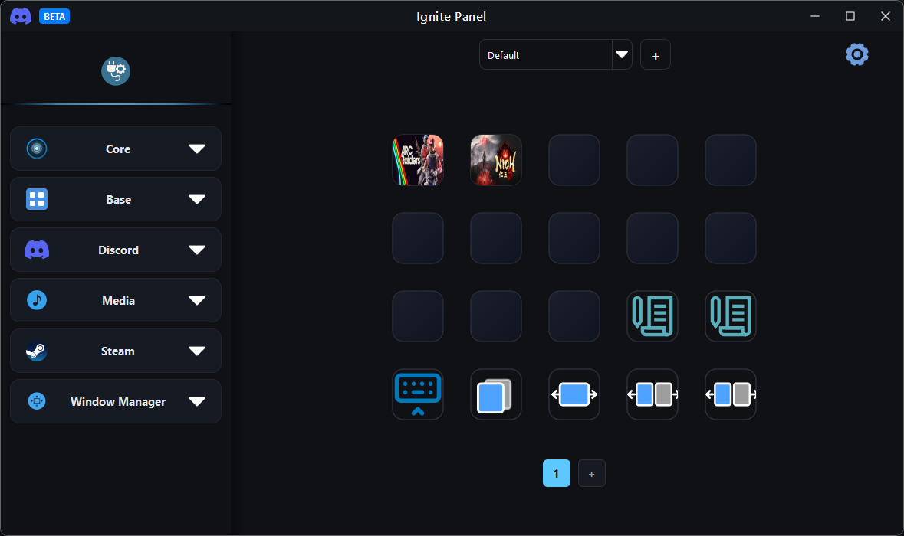
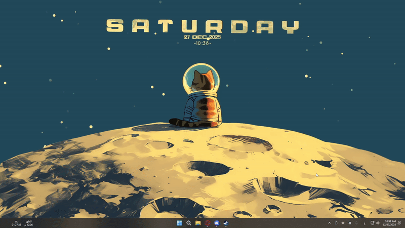

<h1 align="center">Ignite Panel</h1>

  A customizable desktop control panel for shortcuts, applications, and automation.

  <strong>Windows</strong> &nbsp; / &nbsp; Linux (Coming Soon) &nbsp; / &nbsp; Android Companion &nbsp; / &nbsp; 25 Languages

  <a href="https://github.com/iiSHKAS/Ignite-Panel/releases/latest"><strong>Download for Windows</strong></a>
  &nbsp;&nbsp;·&nbsp;&nbsp;
  <a href="https://github.com/iiSHKAS/IgnitePanel-companion-app/releases/latest">Get Android Companion</a>
  &nbsp;&nbsp;·&nbsp;&nbsp;
  <a href="PLUGIN_CREATION_GUIDE.md">Developer Guide</a>

 

  

**Ignite Panel** is a software alternative to Stream Deck and Macro Deck. Create programmable buttons, configure their actions, and control your setup using your keyboard, mouse, or Android phone.

## A Panel Built Around Your Workflow

Set up individual actions or combine them into sequences. Organize your buttons and choose how each one responds.

- **Action configuration** — Add actions, adjust their settings, and assign keyboard or mouse triggers.
- **Multi Action** — Execute a sequence of actions from different plugins with one button.
- **Multi-State Buttons** — Assign separate actions to click, double-click, and long press.

## Plugins & Integrations

Access **13 official plugins** covering system control, media, streaming tools, and application management.

**6 plugins are available by default** on first launch. Install the remaining plugins directly from within Ignite Panel.

Want to add your own integration? The [Plugin Creation Guide](PLUGIN_CREATION_GUIDE.md) covers plugin structure, custom actions, integration, and testing.

## Quick Board

Access your buttons through an on-screen overlay above applications and games. Toggle **Quick Board** with a single shortcut, then use your mouse to trigger actions without returning to the main window.

  

## Android Companion

Turn your Android phone into a wireless controller for your PC. View your configured buttons and trigger their actions remotely.

**[Download the companion app →](https://github.com/iiSHKAS/IgnitePanel-companion-app/releases/latest)**

## Get Started

1. Download **IgnitePanel.exe** from the [latest Windows release](https://github.com/iiSHKAS/Ignite-Panel/releases/latest).
2. Launch Ignite Panel and configure your buttons.
3. Assign triggers, combine actions, or install additional plugins to build your setup.

Ignite Panel supports **25 interface languages**.

---

## Support & Development

Have a question, found a bug, or want to contribute?

- **[Issues & Suggestions](https://github.com/iiSHKAS/Ignite-Panel/issues)** — Report problems and propose features.
- **[Plugin Development](PLUGIN_CREATION_GUIDE.md)** — Create new actions and integrations.
- **[Release History](https://github.com/iiSHKAS/Ignite-Panel/releases)** — Browse available versions and release notes.
